# ATVII: análise crítica, padrões e decisões

Documentação da atividade ATVII do `cinebridge-recomendacao`. Como instalar, rodar e resolver problemas está no [README](../README.md).

## Análise crítica da ATVI

Antes de aplicar os padrões, revisamos o código da ATVI procurando pontos de rigidez (mudança simples exige mexer em vários lugares), fragilidade (mudança num lugar quebra outro) e imobilidade (código que não dá para reaproveitar). O código da ATVI não está mais neste diretório; a coluna "Onde estava" cita arquivo e método, sem número de linha.

| Sintoma | Onde estava no código da ATVI | Consequência | Padrão que resolveu | Onde está agora |
|---|---|---|---|---|
| Rigidez | `Projeto` (`src/domain/entities/Projeto.ts`) era uma classe única. `tipoCaptacao` (`DOCUMENTARIO`, `FICCAO`, `ANIMACAO`) só aparecia no relatório. A lista de tipos estava repetida em `Projeto.ts` (`TIPOS_CAPTACAO`), no enum `TipoCaptacao` do Prisma, no schema Fastify de `recomendacao.routes.ts` e no mapeamento de `PrismaProjetoRepository`. | O tipo não mudava nenhum comportamento. Um tipo novo exigia editar quatro arquivos de camadas diferentes. | Abstract Factory | Uma fábrica por tipo em `src/factories/<tipo>/`, ligadas ao tipo só em `RegistroFabricas`. O schema da rota monta o `enum` com `service.tiposCaptacao()` (tipos registrados) e `projetoParaDominio` reconstrói o subtipo com `fabricas.obter(tipo).criarProjeto(...)`. Para **persistir** um tipo novo, `TIPOS_CAPTACAO` e o enum do Prisma (com migration) ainda precisam mudar. |
| Rigidez | `RecomendacaoService.recomendar` (`src/services/RecomendacaoService.ts`) fazia `new Projeto(dados)`; `gerarRelatorio` fazia `new ValidacaoConsistenciaVisitor(...)`; o construtor do serviço fazia `new ComposicaoEquipeDefault()`. | Criação e validação presas às classes concretas; trocar a classe por tipo exigiria `if`/`switch` no serviço. | Factory Method (`criarProjeto`, `criarValidador`, `criarRelatorio`) | `SistemaRecomendacao.recomendar` chama `fabricas.obter(dados.tipoCaptacao).criarProjeto(dados)`. O orquestrador é criado pela função `criarOrquestrador(fabrica)`, cujo padrão `(fabrica) => new OrquestradorPadrao(fabrica)` fica na raiz de composição `src/composicao/criarSistemaRecomendacao.ts`; quem a chama é o `OrquestradorDeRecomendacao`, com a fábrica do tipo do projeto. `SistemaRecomendacao.gerarRelatorio` entrega a fábrica do tipo ao `GeradorDeRelatorio`, que usa `fabrica.criarRelatorio()` e `fabrica.criarValidador(...)`; o `CompatibilidadeEquipeVisitor`, igual para todos os tipos, chega ao `GeradorDeRelatorio` por função fábrica (`criarCompatibilidade`), definida na raiz de composição. |
| Fragilidade | `PERFIL_PADRAO_POR_PAPEL` (`Projeto.ts`) e a estratégia (`ComposicaoEquipeDefault.aplicarEstrategia`, em `src/orchestration/ComposicaoEquipeDefault.ts`) eram globais, iguais para qualquer gênero. | Ajustar a recomendação de animação ou publicidade significava editar o fluxo comum, com risco de mudar o resultado dos outros tipos. | Abstract Factory + Factory Method (`criarRecomendador`) | `OrquestradorPadrao.aplicarEstrategia` pede o recomendador à fábrica (`fabrica.comEstrategia(base).criarRecomendador()`). Os `RecomendadorDocumentario`/`Animacao`/`Publicitario` (`src/factories/<tipo>/`, base `src/strategies/RecomendadorPorTipo.ts`) decoram a estratégia escolhida. O `PERFIL_PADRAO_POR_PAPEL` em si continua global e não mudou. |
| Fragilidade | `EmailObserver`, `MensagemInternaObserver` e `AuditoriaObserver` (`src/events/observers/`) eram globais e sem noção de tipo. | Uma notificação específica de um tipo exigiria condicionais por tipo dentro desses observers. | Abstract Factory + Factory Method (`criarNotificador`) | Os três observers genéricos continuam sem noção de tipo. Os avisos por tipo ficam em `NotificadorDocumentario`/`Animacao`/`Publicitario` (base `src/events/observadores/NotificadorPorTipo.ts`, que filtra pelo `tipoCaptacao` do evento), criados pela fábrica e registrados uma vez em `src/server.ts`. |
| Imobilidade | Não havia forma de reaproveitar um projeto pronto (papéis, pesos, atributos): cada `POST /projetos/recomendar` começava do zero. | Configurações repetidas eram digitadas de novo a cada cadastro. | Prototype | `Projeto.clonar()` e as sobrescritas nos subtipos (`src/domain/entities/`); `RegistroPrototipos.criarAPartirDe` (`src/prototypes/RegistroPrototipos.ts`); campo `modelo` em `POST /projetos/recomendar` e `GET /projetos/modelos`. |

## Padrões de projeto da ATVII

**Prototype.** `Projeto.clonar(ajustes?)` devolve uma cópia profunda do projeto: novo `id`, novo `criadoEm`, valores atuais (inclusive orçamento, prazo e estratégia alterados depois da criação), papéis com `competenciasDesejadas` e atributos do subtipo copiados. A cópia passa de novo pelo construtor, então os ajustes são validados. `ProjetoDocumentario`, `ProjetoAnimacao` e `ProjetoPublicitario` sobrescrevem `clonar()` e devolvem o próprio tipo. O `RegistroPrototipos` guarda um projeto-modelo por chave (`ficcao`, `documentario`, `animacao`, `publicitario`) e cria projetos novos com `criarAPartirDe(chave, ajustes)`; é usado pelo campo `modelo` de `POST /projetos/recomendar`.

**Abstract Factory.** A interface `FabricaProjeto` (`src/factories/FabricaProjeto.ts`) é implementada por `FabricaFiccao`, `FabricaDocumentario`, `FabricaAnimacao` e `FabricaPublicitario`. Cada uma cria só objetos do próprio tipo, então projeto, validador, recomendador, notificador e relatório sempre combinam entre si.

**Factory Method.** `criarProjeto`, `criarValidador`, `criarRecomendador`, `criarNotificador` e `criarRelatorio` são os métodos de fábrica; cada fábrica concreta decide a classe criada. A base `FabricaProjetoBase` guarda as opções; cada fábrica concreta implementa `comEstrategia(base)`, que devolve uma fábrica da mesma classe usando a estratégia escolhida pelo produtor como base do recomendador.

**Uso no fluxo.** `OrquestradorPadrao` recebe a `FabricaProjeto` no construtor e pede a ela o recomendador na etapa de aplicar a estratégia; não há nenhum `if`/`switch` por tipo em `src/orchestration/` (um teste lê os arquivos e confere). O `SistemaRecomendacao` é uma fachada: pega a fábrica pelo `tipoCaptacao` no `CatalogoFabricas` e delega a montagem da equipe ao `OrquestradorDeRecomendacao`, os convites ao `GestorDeConvites`, os relatórios ao `GeradorDeRelatorio`, a decisão de reavaliar à `PoliticaDeReavaliacao` e a publicação dos eventos ao `PublicadorDeEventosDeRecomendacao` (todos em `src/services/`). É o `OrquestradorDeRecomendacao` que, a cada recomendação ou substituição, cria o orquestrador com `criarOrquestrador(fabrica)` passando a fábrica do tipo do projeto. Todas as dependências chegam por interface; as implementações concretas são escolhidas só em `src/composicao/criarSistemaRecomendacao.ts`, usada pelo `server.ts` e pelos testes. Os notificadores são criados uma vez, no `server.ts`, um por fábrica registrada.

**Tipo novo.** Basta criar a fábrica (e as classes da família) e registrar no `RegistroFabricas`. O teste `tests/integration/fabricas.integration.test.ts` define uma `FabricaRealidadeVirtual` dentro do próprio arquivo e roda o fluxo completo pela API sem mudar orquestrador nem serviço. Para persistir um tipo novo de verdade, ele também precisa entrar em `TIPOS_CAPTACAO` e no enum `TipoCaptacao` do banco (com migration).

### Diagrama de classes -> código

Os nomes do código seguem os do diagrama do enunciado: `OrquestradorEquipe` (`orquestrar`, `validarRestricoes`, `normalizarDados`, `aplicarEstrategia`, `posProcessar`) e `OrquestradorPadrao` em `src/orchestration/`, `SistemaRecomendacao` em `src/services/`, `RecomendacaoStrategy.recomendar` em `src/strategies/` e `Observador.atualizar(evento: EventoRecomendacao)` em `src/events/RecomendacaoEventEmitter.ts`. Até a ATVI, esses três primeiros se chamavam `ComposicaoEquipeTemplate`, `ComposicaoEquipeDefault` e `RecomendacaoService`, e o método da estratégia era `ranquear`; na revisão posterior, `FabricaProjetoRegistry`, `EstrategiaRegistry`, `EmailObserver`, `AuditoriaObserver` e `MensagemInternaObserver` passaram a `RegistroFabricas`, `RegistroEstrategias`, `EmailObservador`, `AuditoriaObservador` e `MensagemInternaObservador`.

O Observer segue a forma Publicador/Assinante: `RecomendacaoEventEmitter` implementa `Publicador` (`adicionar`, `remover`, `notificar`), usando o `EventEmitter` do Node por baixo, e cada `Observador` recebe todo `EventoRecomendacao` em `atualizar(evento)` e trata só os eventos que lhe interessam (pelo `evento.nome`). `publicar(nome, payload)` (interface `PublicadorEventos`, usada pelo `PublicadorDeEventosDeRecomendacao`) e `registrar(...observadores)` são atalhos para `notificar` e `adicionar`.

O que ainda difere do diagrama:

| Diagrama | Código |
|---|---|
| `Projeto` (`clonar(): Projeto`) | `Projeto` (`src/domain/entities/Projeto.ts`), que também é o projeto de ficção |
| `FabricaProjeto` | `FabricaProjeto` (interface) + `FabricaProjetoBase` (classe abstrata com as opções), em `src/factories/FabricaProjeto.ts` |
| Métodos da `FabricaProjeto` | os do diagrama mais um quinto método de fábrica, `criarRelatorio()` (ver D8), e `comEstrategia(base)`, que devolve a mesma fábrica com outra estratégia base no recomendador |
| `FabricaDocumentario` / `FabricaAnimacao` / `FabricaPublicitario` | mesmos nomes, em `src/factories/<tipo>/`, mais `FabricaFiccao` |
| `VisitanteProjeto` (`visitarProjeto`, `visitarProfissional`) | `Visitante` (`src/domain/entities/Visitante.ts`), com um método por elemento concreto, inclusive `visitarProjetoDocumentario`/`Animacao`/`Publicitario`; `ProjetoVisitor<R>` acrescenta `resultado()` e a `VisitanteBase` (`src/visitors/`) dá a visita padrão; os elementos (`Projeto`, `Profissional`, `Recomendacao`, `MembroRecomendado`) implementam `Elemento` |
| `SistemaRecomendacao` | fachada em `src/services/SistemaRecomendacao.ts`; delega a `OrquestradorDeRecomendacao`, `GestorDeConvites`, `GeradorDeRelatorio`, `PoliticaDeReavaliacao` e `PublicadorDeEventosDeRecomendacao`, recebidos por interface |

### Estrutura implementada

O diagrama do enunciado é conceitual; este é o que está no código. Para não repetir 4 vezes a mesma forma, os produtos de cada fábrica aparecem pelas bases: `ValidadorDocumentario`/`Animacao` estendem `ValidadorPapelObrigatorio` e `ValidadorPublicitario` estende `ValidacaoConsistenciaVisitor` (todos visitors sobre a `VisitanteBase`), `RecomendadorDocumentario`/`Animacao`/`Publicitario` estendem `RecomendadorPorTipo` e `NotificadorDocumentario`/`Animacao`/`Publicitario` estendem `NotificadorPorTipo`. A `FabricaFiccao` devolve o `ValidacaoConsistenciaVisitor` base, a própria estratégia escolhida, um `NotificadorFiccao` vazio e o `RelatorioVisitor`.

```mermaid
classDiagram
    class Projeto {
        +id
        +tipoCaptacao
        +detalhes
        +clonar(ajustes) Projeto
        +alterar(alteracoes) ResultadoAlteracao
        +aceitar(visitante)
    }
    class ProjetoDocumentario {
        +tema
        +entrevistados
        +clonar(ajustes) ProjetoDocumentario
    }
    class ProjetoAnimacao {
        +tecnica
        +softwares
        +quadrosPorSegundo
        +clonar(ajustes) ProjetoAnimacao
    }
    class ProjetoPublicitario {
        +marca
        +canais
        +duracaoMaxSegundos
        +clonar(ajustes) ProjetoPublicitario
    }
    Projeto <|-- ProjetoDocumentario
    Projeto <|-- ProjetoAnimacao
    Projeto <|-- ProjetoPublicitario

    class RegistroPrototipos {
        +padrao() RegistroPrototipos$
        +registrar(chave, prototipo)
        +criarAPartirDe(chave, ajustes) Projeto
        +chaves() string[]
    }
    RegistroPrototipos o-- Projeto : modelos clonados

    class FabricaProjeto {
        <<interface>>
        +tipo
        +comEstrategia(base) FabricaProjeto
        +criarProjeto(dados) Projeto
        +criarValidador(dataReferencia) ProjetoVisitor
        +criarRecomendador() RecomendacaoStrategy
        +criarNotificador() Observador
        +criarRelatorio() ProjetoVisitor
    }
    class FabricaProjetoBase {
        <<abstract>>
        #opcoes
        #opcoesComEstrategia(base) OpcoesFabrica
    }
    FabricaProjeto <|.. FabricaProjetoBase
    FabricaProjetoBase <|-- FabricaFiccao
    FabricaProjetoBase <|-- FabricaDocumentario
    FabricaProjetoBase <|-- FabricaAnimacao
    FabricaProjetoBase <|-- FabricaPublicitario

    class RegistroFabricas {
        +padrao(opcoes) RegistroFabricas$
        +registrar(fabrica)
        +obter(tipo) FabricaProjeto
        +tipos()
        +todas()
    }
    RegistroFabricas o-- FabricaProjeto

    FabricaProjeto ..> Projeto : cria
    FabricaProjeto ..> ProjetoVisitor : cria
    FabricaProjeto ..> RecomendacaoStrategy : cria
    FabricaProjeto ..> Observador : cria

    class ProjetoVisitor~R~ {
        <<interface>>
        +visitarProjeto(projeto)
        +visitarProjetoDocumentario(projeto)
        +visitarProjetoAnimacao(projeto)
        +visitarProjetoPublicitario(projeto)
        +visitarRecomendacao(recomendacao)
        +visitarMembro(membro)
        +visitarProfissional(profissional)
        +resultado() R
    }
    class Elemento {
        <<interface>>
        +aceitar(visitante)
    }
    class VisitanteBase~R~ {
        <<abstract>>
        #obterProjetoVisitado() Projeto
    }
    class ValidacaoConsistenciaVisitor {
        #errosDoTipo(projeto) string[]
    }
    Elemento <|.. Projeto
    Elemento <|.. Profissional
    Elemento <|.. Recomendacao
    Elemento <|.. MembroRecomendado
    ProjetoVisitor <|.. VisitanteBase
    VisitanteBase <|-- ValidacaoConsistenciaVisitor
    VisitanteBase <|-- RelatorioVisitor
    VisitanteBase <|-- CompatibilidadeEquipeVisitor
    ValidacaoConsistenciaVisitor <|-- ValidadorPapelObrigatorio
    RelatorioVisitor <|-- RelatorioAnimacaoVisitor

    class RecomendacaoStrategy {
        <<interface>>
        +tipo
        +descricao
        +recomendar(candidatos, contexto) CandidatoPontuado[]
    }
    class RecomendadorPorTipo {
        <<abstract>>
        +base
        #competenciasValorizadas
    }
    RecomendacaoStrategy <|.. CossenoStrategy
    RecomendacaoStrategy <|.. FiltragemColaborativaStrategy
    RecomendacaoStrategy <|.. OrcamentoReduzidoStrategy
    RecomendacaoStrategy <|.. RecomendadorPorTipo
    RecomendadorPorTipo o-- RecomendacaoStrategy : decora

    class Observador {
        <<interface>>
        +nome
        +atualizar(evento: EventoRecomendacao)
    }
    class Publicador {
        <<interface>>
        +adicionar(observador)
        +remover(observador)
        +notificar(evento: EventoRecomendacao)
    }
    class PublicadorEventos {
        <<interface>>
        +publicar(nome, payload)
    }
    Publicador <|.. RecomendacaoEventEmitter
    PublicadorEventos <|.. RecomendacaoEventEmitter
    class NotificadorPorTipo {
        <<abstract>>
        +tipoCaptacao
        +enviadas
    }
    Observador <|.. EmailObservador
    Observador <|.. MensagemInternaObservador
    Observador <|.. AuditoriaObservador
    Observador <|.. NotificadorPorTipo
    Observador <|.. NotificadorFiccao
    NotificadorPorTipo <|-- NotificadorDocumentario
    NotificadorPorTipo <|-- NotificadorAnimacao
    NotificadorPorTipo <|-- NotificadorPublicitario
    RecomendacaoEventEmitter o-- Observador : observadores

    class OrquestradorEquipe {
        <<abstract>>
        +orquestrar(entrada) ResultadoOrquestracao
        #validarRestricoes(entrada)
        #normalizarDados(entrada)
        #aplicarEstrategia(entrada)
        #posProcessar(rankings, entrada)
    }
    class OrquestradorPadrao {
        -fabrica: FabricaProjeto
    }
    OrquestradorEquipe <|-- OrquestradorPadrao
    OrquestradorPadrao --> FabricaProjeto : pede o recomendador

    class SistemaRecomendacao {
        <<fachada>>
        +recomendar(dados)
        +recomendarAPartirDoModelo(modelo, ajustes)
        +aceitarMembro(recomendacaoId, papel)
        +rejeitarMembro(recomendacaoId, papel)
        +substituirMembro(recomendacaoId, papel, estrategia)
        +responderConvite(conviteId, aceito)
        +alterarProjeto(projetoId, alteracoes)
        +gerarRelatorio(recomendacaoId)
        +modelos()
        +tiposCaptacao()
        +tiposEstrategia()
    }
    class RecomendadorDeEquipes {
        <<interface>>
    }
    class ServicoDeConvites {
        <<interface>>
    }
    class GeracaoDeRelatorio {
        <<interface>>
    }
    class EventosDeRecomendacao {
        <<interface>>
    }
    class CriterioDeReavaliacao {
        <<interface>>
    }
    SistemaRecomendacao --> CatalogoFabricas
    SistemaRecomendacao --> CatalogoPrototipos
    SistemaRecomendacao --> RecomendadorDeEquipes
    SistemaRecomendacao --> ServicoDeConvites
    SistemaRecomendacao --> GeracaoDeRelatorio
    SistemaRecomendacao --> EventosDeRecomendacao
    SistemaRecomendacao --> CriterioDeReavaliacao
    CatalogoFabricas <|.. RegistroFabricas
    CatalogoPrototipos <|.. RegistroPrototipos
    RecomendadorDeEquipes <|.. OrquestradorDeRecomendacao
    ServicoDeConvites <|.. GestorDeConvites
    GeracaoDeRelatorio <|.. GeradorDeRelatorio
    EventosDeRecomendacao <|.. PublicadorDeEventosDeRecomendacao
    CriterioDeReavaliacao <|.. PoliticaDeReavaliacao
    OrquestradorDeRecomendacao ..> OrquestradorEquipe : criarOrquestrador(fabrica)
    GeradorDeRelatorio ..> FabricaProjeto : criarRelatorio() e criarValidador()
    PublicadorDeEventosDeRecomendacao --> PublicadorEventos : publicar(nome, payload)

    class ErroDominio {
        <<abstract>>
    }
    ErroDominio <|-- ErroValidacao
    ErroDominio <|-- ErroNaoEncontrado
    ErroDominio <|-- ErroEstadoInvalido
```

## Decisões

O enunciado não define os pontos abaixo; são escolhas nossas.

- **D1 — Tipos.** `PUBLICITARIO` entrou em `tipoCaptacao`. `FICCAO` continua existindo, com a `FabricaFiccao`, que repete o comportamento da ATVI: `Projeto` base, `ValidacaoConsistenciaVisitor`, estratégia escolhida sem ajuste e nenhuma notificação além das genéricas. São 4 fábricas.
- **D2 — Atributos específicos** (campo `detalhes`; todos opcionais, com valor padrão, e validados só quando enviados; valor inválido gera 422):

  | Tipo | Atributos (padrão) |
  |---|---|
  | `DOCUMENTARIO` | `tema` (o gênero), `entrevistados` (`[]`) |
  | `ANIMACAO` | `tecnica`: `2D`, `3D` ou `STOP_MOTION` (`2D`), `softwares` (`[]`), `quadrosPorSegundo` > 0 (`24`) |
  | `PUBLICITARIO` | `marca` (o título), `canais` (`[]`), `duracaoMaxSegundos` > 0 (`duracaoEstimadaMin * 60`) |
  | `FICCAO` | nenhum (`detalhes` é ignorado e volta `null`) |

  Valores derivados (tema, marca, duração máxima) não são copiados no clone quando não foram informados: são recalculados a partir do campo de origem do clone.
- **D3 — Persistência.** Coluna `detalhes JSONB NULL` em `Projeto` (sem herança de tabela) e migration `20261015000000_tipos_de_projeto`. O repositório reconstrói o subtipo pela fábrica do tipo gravado (`RegistroFabricas`).
- **D4 — Prototype.** Modelos padrão: ficção (DIRETOR, ROTEIRISTA, DIRETOR_FOTOGRAFIA, EDITOR), documentário (DIRETOR, ROTEIRISTA, EDITOR; estratégia `ORCAMENTO_REDUZIDO`), animação (DIRETOR, EFEITOS_VISUAIS, SONOPLASTA; 3D, Blender, 24 qps) e publicitário (DIRETOR, DIRETOR_FOTOGRAFIA, EDITOR; 1 min, até 60 s, TV e redes sociais). Com `modelo`, o pedido precisa de `titulo`, `produtorId`, `orcamentoTotal`, `dataEntrega` e `localizacao`; o resto vem do modelo, e o que for enviado sobrescreve. `tipoCaptacao`, se enviado, precisa ser o do modelo. Sem `modelo`, nada mudou.
- **D5 — Fábricas.** Os recomendadores por tipo **decoram** a estratégia escolhida (`COSSENO`, `FILTRAGEM_COLABORATIVA` ou `ORCAMENTO_REDUZIDO`): score final = 80% o da estratégia + 20% a afinidade do profissional com as competências do tipo (documentário: `pesquisa`, `narrativa`, `captacao_som`; animação: `vfx`, `animacao_3d`, `composicao`; publicitário: `ritmo`, `color_grading`, `iluminacao`). O score continua em [0, 1] e `tipo`/`descricao` são os da estratégia, então a API continua mostrando a estratégia escolhida. A estratégia chega à fábrica por `fabrica.comEstrategia(base)`. Validadores: documentário exige `ROTEIRISTA`; animação exige `EFEITOS_VISUAIS`; publicitário exige `duracaoEstimadaMin * 60 <= duracaoMaxSegundos`. Cada regra só vale para o subtipo do próprio tipo, reconhecido pelo despacho duplo do Visitor (`visitarProjetoAnimacao` etc.), sem `instanceof`; com um projeto de outro tipo o validador não acrescenta erros e pode substituir o `ValidacaoConsistenciaVisitor`. Esses erros aparecem em `validacao` do relatório (não bloqueiam a recomendação). Notificadores: avisos simulados próprios do tipo ao gerar a recomendação, ao rejeitar um membro e ao finalizar a equipe; só reagem a eventos do próprio tipo (o `PublicadorDeEventosDeRecomendacao` manda `tipoCaptacao` em todo evento). Os dados de cada aviso (tema, entrevistados, técnica, softwares, marca, canais) também são lidos pelo despacho duplo do Visitor, sem `instanceof`; um projeto do tipo sem a subclasse recebe valores neutros.
- **D6 — Orquestrador.** `new OrquestradorPadrao(fabrica, opcoes?)`. O fluxo validar -> normalizar -> aplicar estratégia -> pós-processar e a trava de `orquestrar()` não mudaram. Regras adotadas pelo `OrquestradorPadrao`: o custo de um profissional é o preço mínimo da faixa dele; o candidato precisa estar disponível da data de referência até a entrega; a escolha é gulosa pelo peso do papel (`EscolhaGulosa`), guardando para cada papel seguinte o preço do candidato livre mais barato; no máximo 3 alternativas por papel (configurável).
- **D7 — Serviço.** `SistemaRecomendacao` recebe todas as dependências por interface (`ProjetoRepository`, `RecomendacaoRepository`, `FonteDeProfissionais`, `CatalogoFabricas`, `CatalogoEstrategias`, `CatalogoPrototipos`, os colaboradores de `src/services/` e o `Relogio`). Os padrões (`RegistroFabricas.padrao()`, `RegistroEstrategias.padrao()`, `RegistroPrototipos.padrao()`, `OrquestradorPadrao`, `FonteProfissionaisResiliente`, limiares de 10% e 7 dias) ficam em `criarSistemaRecomendacao`. O repositório do Prisma também recebe o catálogo de fábricas por construtor, e a estratégia base das fábricas vem do `RegistroFabricas.padrao()` (cosseno).
- **D8 — Relatório por tipo.** O diagrama da `FabricaProjeto` foi usado como guia, mas o texto do enunciado pede, para animação, um "gerador de relatório com métricas de eficiência de renderização". Por isso a fábrica ganhou um quinto método, `criarRelatorio()`, que devolve um `ProjetoVisitor<Relatorio>`. Ficção, documentário e publicitário devolvem o `RelatorioVisitor` (resposta igual à anterior); a animação devolve o `RelatorioAnimacaoVisitor` (`src/factories/animacao/`), que acrescenta `metricasRenderizacao`: técnica, quadros por segundo, duração estimada, total de quadros estimado (duração em segundos × qps), custo estimado por quadro (custo da equipe ÷ total de quadros) e quantidade de papéis `EFEITOS_VISUAIS` preenchidos. Tudo é estimativa derivada dos dados do projeto e da equipe, e o campo só aparece no JSON do relatório de animação.
- **D9 — Configuração e entradas inválidas.** As variáveis de ambiente são lidas e validadas num só lugar (`src/composicao/configuracao.ts`); valor inválido ou `DATABASE_URL` ausente encerram o servidor e o seed com código 1 e mensagem em português. Toda resposta de erro tem o formato `{"erro", "mensagem"}`, inclusive rota inexistente (404) e parâmetro de URL longo demais (414). O que o banco não aceitaria é recusado antes do Prisma: orçamento a partir de 10^12 e duração acima de um inteiro de 32 bits (400, no schema), texto com caractere nulo (400, hook `preValidation`), data com dia inexistente ou ano com mais de 4 dígitos (422, `Data de entrega inválida`) e id fora do formato UUID (404, no repositório). Falhas não tratadas (`unhandledRejection`/`uncaughtException`) são registradas em log e encerram o processo com código 1.
